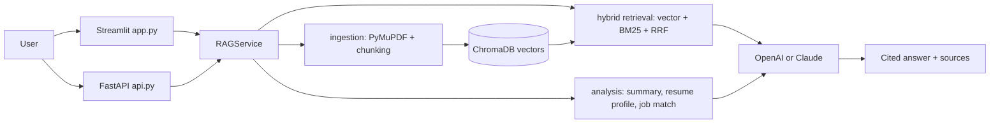

# Talk.AI

**Talk to your documents.** Upload resumes, reports or PDFs, ask questions in a chat, and get answers with the exact passages and page numbers they came from. If a document doesn't contain the answer, Talk.AI says so instead of inventing one.

Built with Python, Streamlit, FastAPI, ChromaDB, LangChain (text splitting), and the OpenAI or Anthropic Claude APIs.

## Problem
Long PDFs hide simple facts, and general chatbots answer confidently even when the fact isn't there. Talk.AI grounds every answer in your own files (retrieval-augmented generation), shows its evidence, and refuses when the evidence is missing.

## Features
- **Multi-document workspace:** upload several PDF/TXT files, search all of them or a chosen subset, delete any time. Indexes persist across restarts and are de-duplicated by file hash.
- **Hybrid search:** dense vector search (ChromaDB) plus BM25 keyword search, merged with Reciprocal Rank Fusion. Finds meaning and exact terms like "Kubernetes".
- **Cited answers, streamed live:** each answer cites excerpt numbers; only cited passages appear as source cards (file, page, relevance).
- **Follow-up questions:** a short query-rewrite step turns "and where?" into a standalone search.
- **Refusal on missing evidence:** strict grounding prompt, exact "not found" reply, and no LLM call when nothing is retrieved.
- **Summary:** map-reduce summarisation for long documents.
- **Resume profile:** skills (as tags), education, experience, projects, extracted as validated JSON (Pydantic) with one automatic repair retry.
- **Job match:** compare a resume with a job description: score, matched and missing skills, strengths, and improvement suggestions.
- **REST API:** FastAPI endpoints (`/documents`, `/ask`, `/summary`, `/resume`, `/match`) with interactive docs at `/docs`.
- **Reliability:** retries with backoff for rate limits and 5xx errors, clear messages for bad keys, bad files, empty files, scanned PDFs.
- **Quality tooling:** 35 automated tests, a retrieval evaluation script, Docker, and GitHub Actions CI.

## Architecture

| Module | Role |
|---|---|
| `talkai/ingestion.py` | validate files, extract text with page numbers, split into chunks |
| `talkai/store.py` | ChromaDB collection, document registry, vector search |
| `talkai/retrieval.py` | BM25 + hybrid ranking |
| `talkai/rag.py` | query rewrite, grounded prompt, citations, streaming |
| `talkai/analysis.py` | summary, resume profile, job match (Pydantic-validated) |
| `talkai/llm.py` | OpenAI/Anthropic clients, retry, friendly errors |
| `app.py`, `api.py` | Streamlit UI, FastAPI backend |
| `evaluation/` | labelled questions and metrics script |

## Setup (Windows PowerShell)
```powershell
cd ai-resume-document-copilot
python -m venv .venv
.\.venv\Scripts\Activate.ps1        # if blocked: Set-ExecutionPolicy -Scope CurrentUser RemoteSigned
pip install -r requirements.txt
Copy-Item .env.example .env
code .env                           # add OPENAI_API_KEY (or ANTHROPIC_API_KEY and LLM_PROVIDER=anthropic)
streamlit run app.py                # UI on http://localhost:8501
uvicorn api:app --reload            # API on http://localhost:8000/docs (second terminal)
```
Docker: `docker compose up --build`.

An API key is required for answers, summaries, profiles and matching. With `EMBEDDING_BACKEND=auto`, an OpenAI key also provides embeddings; with only an Anthropic key, a local MiniLM embedding model is downloaded once (about 80 MB).

## Testing and evaluation
```powershell
python -m pytest -v                                  # 35 tests, no API key needed
python -m evaluation.run_eval --embedding local      # retrieval metrics, no API key
python -m evaluation.run_eval --embedding auto --llm # end-to-end answer + refusal accuracy (uses your key)
```
Tests stub the LLM with a scripted fake, so they verify the pipeline logic, not model quality. The `--llm` run measures real model behaviour.

**Retrieval results** (14 questions, 2 sample documents, 12 chunks, offline keyword-hash embeddings, k=3):

| Method | hit@3 | MRR |
|---|---|---|
| Vector only | 0.667 | 0.625 |
| BM25 only | 0.583 | 0.583 |
| Hybrid (RRF) | 0.833 | 0.736 |

This is a small sanity check, not a benchmark: it shows hybrid retrieval beating each method alone on this set. Re-run with `--embedding openai` for neural-embedding numbers, and grow `evaluation/dataset.jsonl` with your own documents.

## Deploy
**Streamlit Community Cloud:** push to GitHub, open share.streamlit.io, select the repo and `app.py`, and add secrets (`LLM_PROVIDER`, `OPENAI_API_KEY`). Storage there is temporary, so documents must be re-uploaded after a restart.
**Docker / any VPS:** `docker compose up -d` runs the UI and API with a shared volume.

## Screenshots
Add images to `docs/` (chat with sources, resume profile, job match) and link them here.

## Limitations and next steps
- No OCR: scanned PDFs are rejected with a clear message. Tables and multi-column layouts may extract poorly.
- Single-user, no authentication; BM25 is rebuilt per query, which is fine for tens of documents, not thousands.
- Job-match scores are model judgements and should be treated as guidance.
- Next: OCR, reranking with a cross-encoder, user accounts, answer-faithfulness scoring, larger evaluation set.
